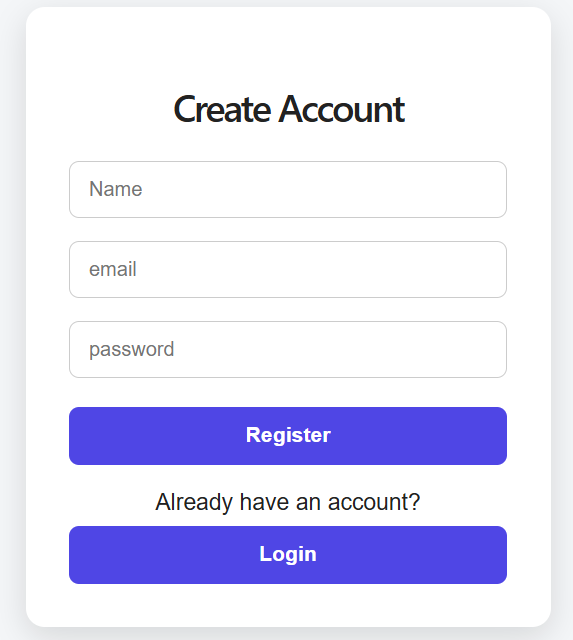
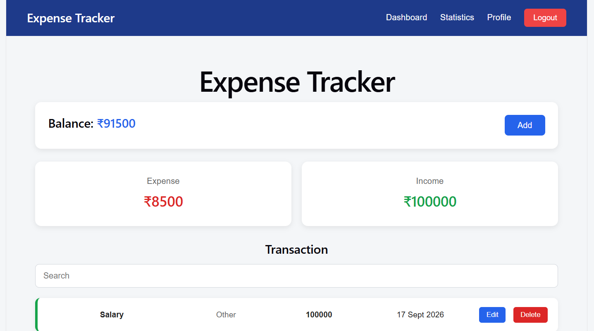
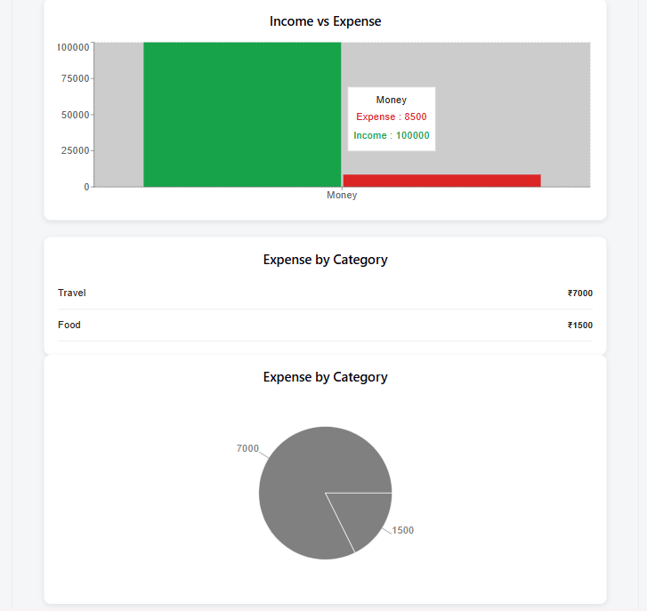
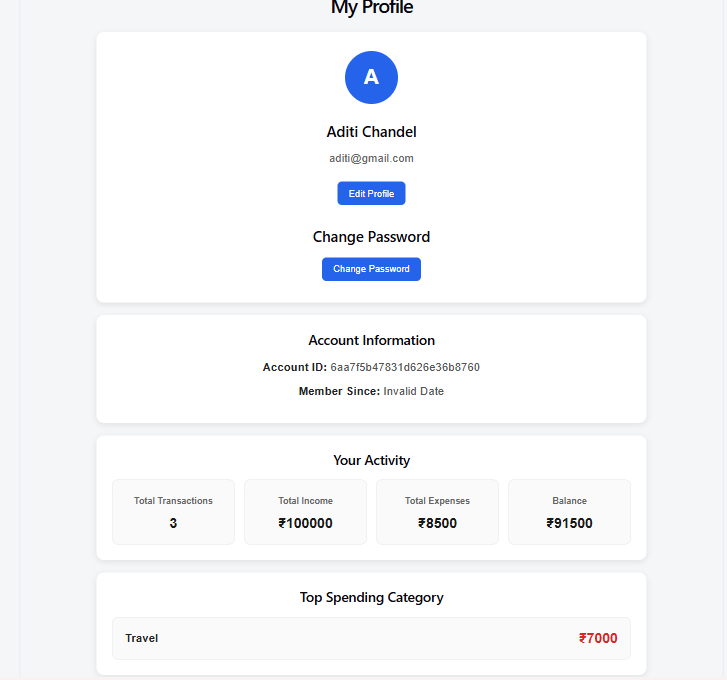

# 💰 Expense Tracker

A full-stack personal finance application built with React, Node.js, Express, and MongoDB to help users manage expenses, track transactions, and visualize spending patterns.

## 🌐 Live Demo

**[🚀 Try Expense Tracker](https://expense-tracker-frontend-liard-mu.vercel.app/register)**

## 📖 About the Project

Expense Tracker is a full-stack web application that allows users to manage their financial transactions through an intuitive interface. It includes user authentication, transaction management, a dashboard, and statistics to help users understand their spending habits.

The frontend is deployed on Vercel, the backend on Render, and MongoDB Atlas is used for database storage.

## ✨ Features

- **User Authentication:** Register and log in to an account.
- **Transaction Management:** Add, view, and delete financial transactions.
- **Dashboard:** View transaction information in one place.
- **Statistics and Charts:** Analyze spending patterns through visualizations.
- **User Profile:** Access profile-related functionality.
- **Protected Routes:** Restrict access to authenticated pages.
- **Persistent Database:** Store transaction data in MongoDB.
- **Responsive UI:** Access the application across different screen sizes.

## 📸 Screenshots

### Registration Page


### Dashboard


### Statistics


### Profile



## 🛠️ Tech Stack

| Technology | Purpose |
|---|---|
| React.js | Frontend user interface |
| Vite | Frontend development and build tool |
| React Router | Client-side navigation |
| CSS | Styling and responsive layout |
| Node.js | Backend JavaScript runtime |
| Express.js | REST API and server-side logic |
| MongoDB Atlas | Database |
| JWT | Authentication tokens |
| Vercel | Frontend deployment |
| Render | Backend deployment |

## 🏗️ Project Structure

```text
Expense-Tracker/
├── Frontend/
│   ├── src/
│   ├── public/
│   ├── package.json
│   └── ...
├── backend/
│   ├── package.json
│   └── ...
├── screenshots/
│   ├── register.png
│   ├── dashboard.png
│   ├── statistics.png
│   └── profile.png
└── README.md
|__ .gitignore
```


## ⚙️ Installation and Setup

### Prerequisites

- Node.js and npm
- A MongoDB Atlas database or local MongoDB instance
- Git

### 1. Clone the repository

```bash
git clone https://github.com/AbhipshaChandel/Expense-Tracker.git
cd Expense-Tracker
```

### 2. Configure and run the backend

```bash
cd Backend
npm install
```

Create a `.env` file inside the `Backend` directory:

```env
MONGO_URI=your_mongodb_connection_string
JWT_SECRET=your_secret_key
NODE_ENV=development
```

Start the backend using the script defined in `Backend/package.json`:

```bash
npm start
```

### 3. Configure and run the frontend

Open a second terminal from the repository root:

```bash
cd Frontend
npm install
```

Create a `.env` file inside `Frontend`:

```env
VITE_API_URL=http://localhost:5000
```

Start the frontend:

```bash
npm run dev
```

Open the local URL displayed in the terminal.


## 🔌 API Overview

The backend provides API endpoints for authentication and financial transaction management.

| Feature | Endpoint example |
|---|---|
| Register | `POST /api/auth/register` |
| Login | `POST /api/auth/login` |

Add your transaction and profile endpoints here after verifying their exact routes in your backend code.

## 🚀 Deployment

- **Frontend:** [Vercel](https://vercel.com/)
- **Backend:** [Render](https://render.com/)
- **Database:** [MongoDB Atlas](https://www.mongodb.com/atlas)

The frontend communicates with the backend using the `VITE_API_URL` environment variable.

## 🔒 Security

- Keep database credentials and JWT secrets in environment variables.
- Never commit `.env` files containing real secrets.
- Ensure passwords are securely hashed.
- Verify authentication on protected backend endpoints.
- Ensure users can access only their own financial records.

## 🔮 Future Improvements

- Monthly budgets and spending limits
- Category-wise expense breakdowns
- Search and date-range filtering
- Export transactions to CSV or Excel
- Monthly financial reports and insights

## 👨‍💻 Author

**Abhipsha Chandel**

- GitHub: [AbhipshaChandel](https://github.com/AbhipshaChandel)
- Project Repository: [Expense Tracker](https://github.com/AbhipshaChandel/Expense-Tracker)

---

⭐ If you find this project useful, consider giving the repository a star.
